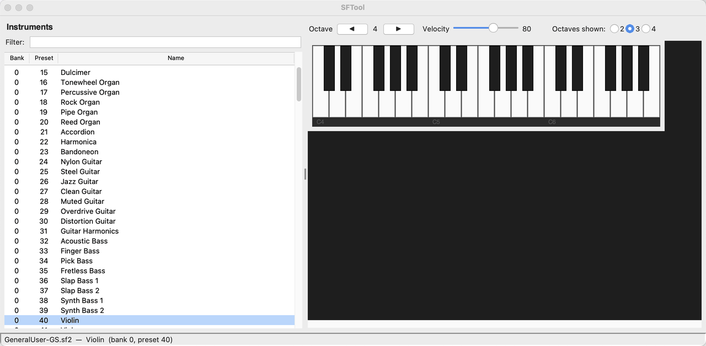

# SFTool

Browse and preview SF2 soundfonts in a desktop GUI or terminal UI.

Documentation: [lucidbeaming.com/art/code/sftool](https://lucidbeaming.com/art/code/sftool)



A cross-platform soundfont (`.sf2`) browser and preview tool written in Python. Load a soundfont, find an instrument, and play it on an on-screen or computer keyboard.

## Features

- Load any SF2 soundfont and browse all presets by bank and number
- Filter instruments by name in real time
- Preview any instrument across octaves using an on-screen keyboard (GUI) or your computer keyboard (TUI)
- Adjust velocity and octave on the fly
- Auto-detects headless/SSH environments and falls back to TUI mode

## Requirements

- Python 3.11+. The GUI needs a Python built with Tk: `python3 -m tkinter` should open a small test window. Some pyenv and Homebrew Pythons don't include it; the [uv](https://docs.astral.sh/uv/)-managed and python.org builds do. The TUI doesn't need Tk.
- [FluidSynth](https://www.fluidsynth.org/) (native library, installed separately)
- `pyfluidsynth` (Python binding, installed via pip)

### Install FluidSynth

**macOS**
```bash
brew install fluid-synth
```

**Ubuntu / Debian**
```bash
sudo apt install fluidsynth
```

**Fedora**
```bash
sudo dnf install fluidsynth
```

**Windows**
Download the installer from https://github.com/FluidSynth/fluidsynth/releases and add the `bin/` directory to your `PATH`.

### Install SFTool

```bash
git clone https://github.com/lucidbeaming/sftool.git
cd sftool
pip install -r requirements.txt
```

### A soundfont to try

Any General MIDI soundfont works. [GeneralUser GS](https://schristiancollins.com/generaluser.php) by S. Christian Collins is free and has 287 presets. Save it anywhere and pass its path. (`examples/` is the one folder where `.sf2` files aren't git-ignored, so keep third-party soundfonts out of it if you commit.)

## Usage

### GUI mode (default)

```bash
python main.py
python main.py path/to/file.sf2   # open a soundfont on launch
```

A tkinter window opens with a resizable instrument list on the left and an interactive piano keyboard on the right (screenshot at the top). The status bar shows the soundfont and the selected instrument.

**GUI controls:**

| Action | How |
|---|---|
| Open soundfont | File → Open Soundfont, or `Cmd/Ctrl+O` |
| Select instrument | Click a row in the list |
| Filter instruments | Type in the filter box above the list |
| Play a note | Click and hold a piano key |
| Slide between notes | Click and drag across keys |
| Change octave | `◀` / `▶` buttons |
| Adjust velocity | Drag the slider |
| Change octaves shown | 2 / 3 / 4 radio buttons |

### TUI mode (terminal)

```bash
python main.py --tui
python main.py --tui path/to/file.sf2
```

On systems without a display (SSH, headless servers) the TUI is selected automatically.

```
 ♪ SFTool ─────────────────────── [O]Open  [/]Filter  [↑↓]Navigate  [z/x]Oct  [,/.]Vel  [Q]Quit
 Instruments 287/287            │  ♪  Violin                                  Bank 0  Preset 40
   0:19   Pipe Organ            │───────────────────────────────────────────────────────────────
   0:20   Reed Organ            │ Octave: 4  [z]▼ [x]▲    Velocity: 80  [,]▼ [.]▲
   0:21   Accordion             │
   0:22   Harmonica             │ ┌───┬───┬───┬───┬───┬───┬───┐
   0:23   Bandoneon             │ │  ░░  ░░   │  ░░  ░░  ░░   │
   0:24   Nylon Guitar          │ │  ░░  ░░   │  ░░  ░░  ░░   │ oct 4
   0:25   Steel Guitar          │ │   │   │   │   │   │   │   │
   0:26   Jazz Guitar           │ │C  │D  │E  │F  │G  │A  │B  │
   0:27   Clean Guitar          │ └───┴───┴───┴───┴───┴───┴───┘
   0:28   Muted Guitar          │
   0:29   Overdrive Guitar      │   [w] [e]     [t] [y] [u]
   0:30   Distortion Guitar     │ [a] [s] [d] [f] [g] [h] [j] [k]   z/x=oct  ,/.=vel
   0:31   Guitar Harmonics      │
   0:32   Acoustic Bass         │
   0:33   Finger Bass           │
   0:34   Pick Bass             │
   0:35   Fretless Bass         │
   0:36   Slap Bass 1           │
   0:37   Slap Bass 2           │
   0:38   Synth Bass 1          │
   0:39   Synth Bass 2          │
   0:40   Violin                │
 [/] filter                     │
    GeneralUser-GS.sf2  (287 presets)
```

(GeneralUser GS in a 96×26 terminal, Violin selected.)

**TUI controls:**

| Key | Action |
|---|---|
| `↑` / `↓` | Navigate instrument list |
| `PgUp` / `PgDn` | Jump 10 instruments |
| `Home` / `End` | First / last instrument |
| `/` | Enter filter mode — type to narrow the list |
| `Esc` | Exit filter mode and clear the filter |
| `O` | Open a soundfont by typing its path |
| `z` / `x` | Octave down / up |
| `,` / `.` | Velocity −5 / +5 |
| `Q` | Quit |

**Piano keyboard layout:**

```
    [w] [e]       [t] [y] [u]
  [a] [s] [d]  [f] [g] [h] [j] [k]
   C  C#  D  D#  E   F  F#  G  G#  A  A#  B  C
```

Notes ring for ~0.45 seconds. Pressing a key while its note is still sounding restarts the envelope.

## Project structure

```
sftool/
├── main.py           Entry point — routes to GUI or TUI
├── requirements.txt
└── sftool/
    ├── sf2.py        Zero-dependency SF2 preset reader (parses PHDR chunk)
    ├── player.py     FluidSynth wrapper — loads SF2, plays/stops notes
    ├── keyboard.py   Clickable piano keyboard widget (tkinter Canvas)
    └── tui.py        Full-screen terminal UI (curses)
```

### Why no `sf2utils` dependency?

`sf2utils` dropped support for Python 3.13+ (it uses the removed `audioop` module). `sftool` ships a minimal PHDR-chunk parser in `sf2.py` that has no dependencies beyond the standard library and works on all Python versions.

## Troubleshooting

**`No module named 'fluidsynth'`** — run `pip install pyfluidsynth`.

**FluidSynth library not found on macOS** — make sure you ran `brew install fluid-synth`. The library should be at `/opt/homebrew/lib/libfluidsynth.dylib`. `main.py` adds this path to `DYLD_LIBRARY_PATH` automatically.

**No sound on Linux** — FluidSynth tries PulseAudio then ALSA. Check that your audio server is running: `pactl info` or `aplay -l`.

**TUI is garbled** — make sure your terminal emulator supports UTF-8 and 256 colours. Set `TERM=xterm-256color` if needed.

## Related projects

- [Fluidsynth-Webapp](https://github.com/lucidbeaming/Fluidsynth-Webapp): a web app for switching FluidSynth instruments over its shell
- [pi-synths](https://github.com/lucidbeaming/pi-synths): scripts for building music machines on Raspberry Pi

## License

[MIT](LICENSE).
